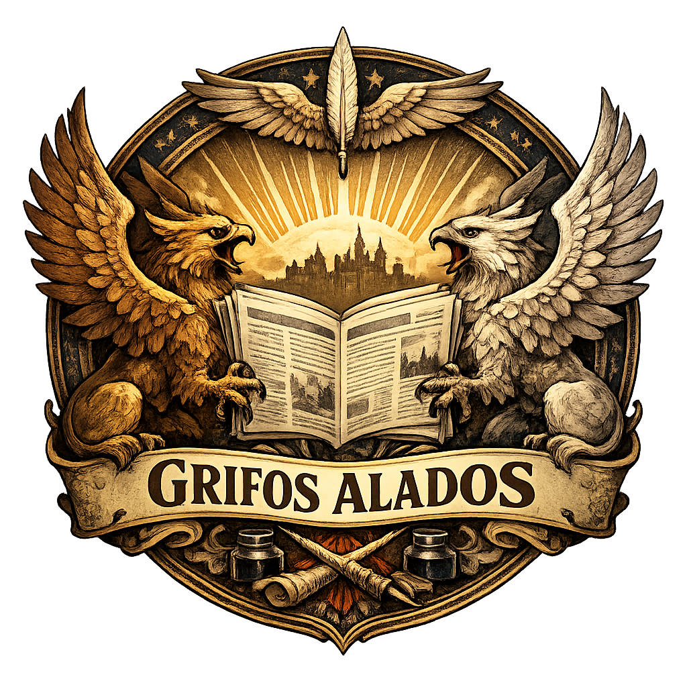
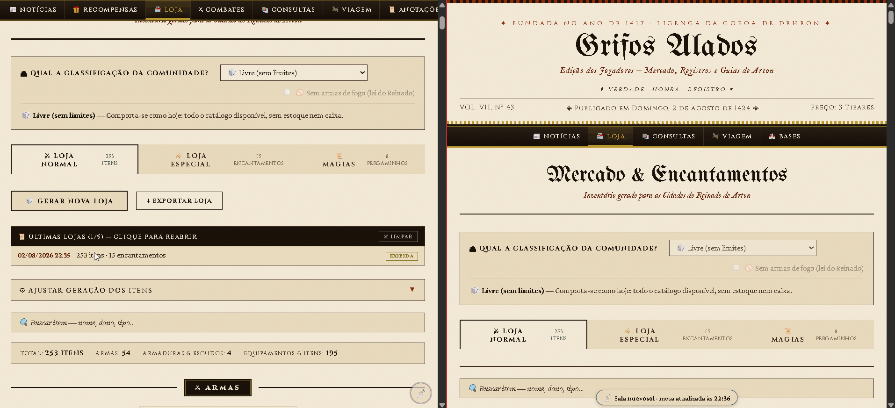

<div align="center">
  

  # 🦅 Grifos Alados

  **A bancada do mestre de _Tormenta 20_**, no formato de um jornal de Arton.
  Bestiário, oficina de ameaças, loja, recompensas, fichas de jogador, viagens, bases,
  calendário e uma mesa ao vivo — num site só.

  ### 👉 [**Abrir o site**](https://grifos-alados.vercel.app/) · 📡 [**Edição dos jogadores**](https://grifos-alados.vercel.app/jogadores.html?sala=mesa)

  _Sem instalar, sem cadastro, sem mensalidade. Abre e usa._
</div>

<div align="center">
  
  <br>
  <sub><strong>Mesa ao vivo</strong> — o mestre rola uma loja nova (à esquerda) e a tela dos
  jogadores (à direita) acompanha.</sub>
</div>

---

## O que é

Tudo o que eu precisava ter aberto numa sessão de Tormenta 20 estava espalhado em PDF,
planilha e aba do navegador. O Grifos Alados juntou isso numa gazeta só.

Roda inteiro no navegador: **sem servidor, sem cadastro e sem custo**. O que você cria
fica guardado no seu navegador, e cada aba tem botão de **backup `.json`**. A mesa ao vivo
(opcional) usa Firebase, e mesmo ela não exige login para quem só quer assistir.

## 📚 Os livros que estão aqui

As regras não foram resumidas: foram transcritas e conferidas contra o PDF, página por
página, com a fonte anotada em cada tela.

| Livro | O que entrou |
|---|---|
| **Tormenta 20 — Jogo do Ano** | 80 criaturas, as 29 perícias, condições, ações de combate, itens, magias, a tabela de recompensas |
| **Ameaças de Arton** | **430 criaturas** nas 30 seções do Capítulo 1, o manual de criação de ameaças (Cap. 2), 26 raças, materiais especiais, recursos naturais |
| **Deuses de Arton** | 76 criaturas (avatares, abissais, celestiais, fadas, gênios, gigantes), 20 deuses com poderes concedidos, 23 distinções |
| **Heróis de Arton** | 36 distinções, poderes de classe novos, raças, origens, complicações, itens nomeados |
| **Atlas de Arton** | 66 origens regionais |
| **Guia de NPCs** | 94 fichas de gente comum, regras de raça, truques mercenários, o quadro d'O Templo |
| **Guia de Deuses Menores** | deuses menores e poderes concedidos |

Em números: **680 fichas de criatura**, **1.005 poderes** (365 deles de **59 distinções**),
**636 poderes de classe** em 16 listas, **218 habilidades fixas** das 30 classes,
**254 magias**, **867 itens descritos**, **232 itens mágicos nomeados**, **131 origens**,
**49 raças**, **147 poderes concedidos**, **103 perigos** + 17 complexos, **73 montarias**,
**54 complicações**, **35 condições**.

## 🧰 As abas

| Aba | O que faz |
|-----|-----------|
| 📰 **Notícias** | A gazeta de cada campanha, com o **calendário artoniano** (data, estação e o dia da semana). |
| 🎁 **Recompensas** | Dinheiro e itens por ND. Modo **Padrão** (Tabela 8-1 oficial, 180/180 conferidos) ou **Customizável**, com filtros, pergaminhos e itens superiores encantados. |
| 🏪 **Loja** | Monta o estoque de uma loja — mundanos, superiores, **232 itens mágicos nomeados**, pergaminhos pela regra do Escriba Arcano, serviços. |
| ⚔ **Combates** | Bestiário vivo: iniciativa por campanha, PV/PM atuais, condições com imunidade, críticos, efeitos em área, cura e dano por turno. Cada atributo tem a **sua caixa**, com 🎲 de teste e a perícia fora da lista já calculada; o **📖** abre a ficha em modo leitura, fonte grande, para a mesa. Dá para colar o statblock do livro e ele **preenche os campos sozinho**. |
| 📕 **Fichas Prontas** | Os quatro bestiários inteiros, com busca, e um botão que manda a criatura para a cena. |
| ⚗ **Criar Ameaça** | O manual de criação de ameaças (p. 377–389) funcionando: escolha papel e ND e a Tabela 2-3 preenche Defesa, PV, ataque, dano médio, CD e resistências. Tem **🔧 Modificar** e **👥 Bando**, que guardam a diferença da criatura original ao mudar o ND. Dá **poderes da Tormenta** e **distinções** à criatura, com os valores já somados. |
| 👤 **Fichas (jogador)** | Ficha de personagem completa: 30 classes, magias que rolam o dado certo, poderes, distinções, inventário, XP, passos de dano, atributos temporários, aviso de início de turno. |
| 📚 **Consultas** | Referência rápida: perigos, veículos, animais e montarias, arsenal, regras de ameaças, de magia, ações e combate, culinária. |
| 🐎 **Viagem** | Viagens com meio de transporte, eventos e **combates de viagem** ligados ao bestiário. |
| 📜 **Anotações** | Ramos de anotação e um **mapa/linha do tempo** com nós arrastáveis. |
| 🏰 **Bases** | Refúgios: cômodos, mobília, custos (Sítio Sagrado a ½) e inventário. |
| ⏳ **Tempo** | Atividades de tempo livre entre aventuras, com registro por jogador. |
| 🎲 **Mesa** | Suas campanhas: quem entra, o que é público e o que é só seu. |

## 📡 Mesa ao vivo

Existe uma **edição dos jogadores** que mostra, só para ver, a **Loja** que o mestre
rolou, as **Bases**, as **Viagens**, as **Notícias** e as **Consultas**. Quando o mestre
mexe, a tela deles acompanha.

| Página | Link |
|--------|------|
| 🛠 **Bancada** (sua, local — não transmite) | <https://grifos-alados.vercel.app/> |
| 🎲 **Mestre de uma campanha** | <https://grifos-alados.vercel.app/?mesa=mesa> |
| 👥 **Jogadores** (só visualiza) | <https://grifos-alados.vercel.app/jogadores.html?sala=mesa> |

**A campanha está no endereço.** O site sem `?mesa=` é a sua bancada: tudo fica neste
navegador e o 📡 não transmite para ninguém. Com `?mesa=<campanha>`, aquela aba **é**
aquela campanha — a Loja, as Bases e as Viagens que você mexer ali são dela. Cinco
campanhas são cinco abas.

O mestre liga a transmissão pelo **📡** (canto inferior direito). A sincronização usa o
**Firebase**, e a configuração (uma vez só) está em **[`MODO-JOGADOR.md`](MODO-JOGADOR.md)**.

> 🔑 **Ver a mesa não pede login.** Para **escrever** nas poucas caixas que são dos
> jogadores — o inventário do grupo, os residentes de uma base, o diário da viagem — eles
> entram com o Google pelo selinho do rodapé, e só as contas que o mestre listou passam.
> Quem não entrou vê um "🔒 entre para escrever".

> 💾 **Seus dados** ficam no **seu** navegador (`localStorage` e `IndexedDB`): sobrevivem
> a fechar a aba, mas são por dispositivo. Use o **Backup (.json)** de cada aba para
> guardar ou levar para outro computador.

## ♿ Acessibilidade

No **celular**, as seções viram uma gaveta (o ☰ da barra fixa, que diz onde você está), o
texto começa um degrau maior e as tabelas largas rolam sozinhas.

O **⚙ Acessibilidade**, no canto do cabeçalho, ajusta **tamanho do texto** em cinco
degraus, **mais contraste**, **menos movimento** e **foco sempre visível** — fica salvo e
vale nas duas edições. Tem **modo noturno**.

Pelo **teclado**: `Tab` entra no menu uma vez e as **setas** andam entre as seções; há um
"Pular para o conteúdo" no topo, `Esc` fecha gaveta e janelas, e as tabelas largas rolam
com as setas.

## 💻 Rodar local

O site é estático: para usar offline, abra o `index.html` com duplo-clique. Para servir
numa porta (útil para testar em celular na mesma rede):

```bash
npx http-server -p 8080 -c-1 .
```

As **Notícias** se publicam pelo botão **⬇ Baixar arquivo** da própria aba, que gera o
`js/noticias-data.js` pelo navegador — depois é só commit e push. (Existe um
`backend/server.py` em Flask que faz o mesmo automaticamente, mas ele é opcional.)

## 🗂️ Estrutura

```
Grifos-Alados/
├── index.html          ← a bancada do mestre
├── jogadores.html      ← a edição dos jogadores (só leitura)
├── css/                ← um arquivo por aba
├── js/                 ← lógica e dados (Vanilla JS, sem framework nem build)
├── fonts/              ← fontes embutidas, para funcionar offline
├── data/               ← noticias.json
├── img/                ← imagens do README
├── Fichas/             ← modelo de ficha T20 em branco (PDF)
└── backend/            ← server.py, opcional, só para as Notícias
```

## 🛠️ Tecnologia

HTML, CSS e **JavaScript puro**. Sem framework, sem build, sem `node_modules`: o que está
no repositório é o que roda. Persistência em `localStorage` e `IndexedDB`; a mesa ao vivo
usa Firebase Realtime Database. Hospedado na **Vercel** (e espelhado no GitHub Pages).

## 🤝 Achou um erro de regra?

Abra uma [issue](https://github.com/BlafXD/Grifos-Alados/issues) dizendo o livro e a
página. Erro de regra é o tipo de bug que mais importa aqui.

---

<div align="center">
  <sub>Projeto de fã, sem fins lucrativos e sem vínculo com a editora.<br>
  <em>Tormenta 20</em> é propriedade da <a href="https://jamboeditora.com.br/">Jambô Editora</a>.
  Este site não substitui os livros — compre os livros.</sub>
</div>
